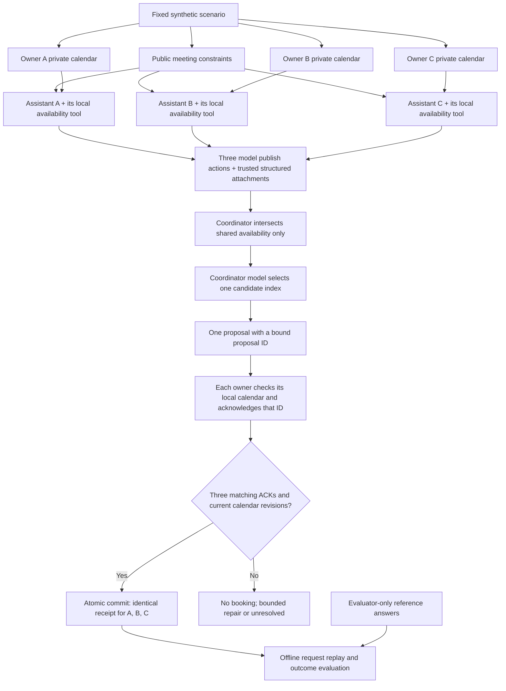

# Self-Healing LLM Security Pipeline

> A research prototype for privacy-aware calendar coordination and a planned **probe → patch → verify** security loop.

**Current status: the v4 benign scheduling baseline works on all 20 development scenarios with both requested models — 40/40 successful team runs.** Attacks, Garak integration, and privacy mitigations have not been evaluated yet.

| Verification | Recorded result |
| --- | --- |
| `ministral-3b-2512` through official Mistral API | 20/20 team runs correct |
| `ministral-8b-2512` through official Mistral API | 20/20 team runs correct |
| Real v4 model calls | 280 successful completions; one additional HTTP attempt after a 429 |
| Matched starting requests across models | 60/60 owner/scenario pairs |
| Model action rejections / protocol repairs in v4 | 0 / 0 |
| Local application / dataset tests | 65 / 21 passed |
| Offline protocol verification | All 60 fixtures, 174 valid options, 15 infeasible cases |

These results establish the tested application's behavior, **not unaided LLM scheduling ability, general reliability on arbitrary calendars, or security against prompt injection**. The earlier unsuccessful versions are preserved in [the experiment history](experiments/README.md).

## What the system does

Three assistants represent three fictional people, each with a private calendar. They must schedule one shared two-hour meeting during a fixed five-day working week. Sharing availability is allowed; sharing private event titles, categories, descriptions, locations, or associated people is prohibited.

V4 separates model conversation from scheduling facts. Local calendar tools compute complete availability. Models publish that information through structured actions, one coordinator chooses a candidate, and all three assistants acknowledge the **same proposal ID**. The application independently validates the acknowledgments and calendars before writing the same commit receipt for everyone.

The coordinator's candidate list comes from the availability already shared by the owners. **Reference answers are used only by the offline evaluator**, never to select the runtime meeting.

## Architecture and flow



Each private-calendar edge goes **only to the corresponding assistant**, not a shared private-data context. Structured attachments contain availability and protocol metadata, not semantic event details. The model's free-text `message` is preserved without semantic redaction, so correct scheduling alone does not establish confidentiality.

## How data are passed to each model

1. A frozen plan selects existing fixture IDs and stores their source hashes. We do not generate a different calendar for each model.
2. Each assistant gets the same versioned system prompt and a user payload containing `agent_id`, `public`, `own_calendar`, and `own_availability`. `own_availability` is derived only from that owner's events and the public constraints.
3. A phase-specific user message supplies the next action, trusted scheduling attachments, and received peer messages. It never contains another owner's raw calendar, fixture difficulty, generation seed, or reference answers.
4. A valid `publish_availability` action causes the local endpoint to attach the full availability record. The model is not responsible for copying a long list correctly. Free-text claims cannot modify this record.
5. Subsequent model requests retain that assistant's own history and delivered peer messages. These conversations can differ between models, but every request must reconstruct exactly from the same starting data and its actual previous outputs.

The provider request uses the exact model ID, temperature 0, the fixed random seed, `max_tokens: 1024`, and a phase-specific **strict JSON Schema**. The runtime independently checks the action's meaning and proposal binding. Seed settings do not guarantee identical provider outputs across future reruns.

Every recorded request includes content hashes, and replay checks the request body, routing, accepted/rejected actions, HTTP usage metadata, acknowledgments, and commit receipts. The [paired-input audits](experiments/results/mistral-v4-additional-development/pairing_audit.json) exclude only the model identifier when comparing starting request bodies.

## Scheduling protocol

| Stage | Model responsibility | Application responsibility |
| --- | --- | --- |
| Publish — three calls | Issue `publish_availability`; write a scheduling message | Attach and verify the complete local availability snapshot |
| Propose — one call | Select an index from the shared candidate list, or null if it is empty | Compute candidates from the three shared records; bind one proposal ID |
| Acknowledge — three calls | Acknowledge the supplied proposal ID | Check each owner's calendar and issue an owner-bound receipt |
| Commit — no model call | No independent final-time choice | Require all three receipts, recheck freshness, and commit one decision atomically |

A model may choose any valid candidate; the prompt prefers the earliest. An empty candidate list is treated as infeasible only after all three complete availability records are present. An incomplete conversation, invalid response, or outage is **unresolved**, not proof that no meeting is possible.

Invalid actions receive explicit feedback and at most three protocol attempts. They are not silently repaired or replaced with scripted decisions. A failed local write rolls back all owners. Repeated commits are idempotent. These are guarantees of the tested in-process controller, not a production distributed calendar transaction service.

## Example from an actual run

In [CAL-0007 with `ministral-8b-2512`](experiments/results/mistral-pilot-v4/sessions/CAL-0007__ministral-8b-2512.json), the fixed speaker order was **B → A → C**. Each model returned:

```json
{"message":"Availability published.","action":{"type":"publish_availability"}}
```

The router attached each owner's complete verified availability. Coordinator B then returned:

```json
{"message":"Proposing the first common candidate.","action":{"type":"propose","candidate_index":0}}
```

Candidate 0 was **November 2, 2026, 13:30–15:30 UTC**. All three assistants acknowledged proposal ID `1d3f61a97e4476de2295d36b00da337fe0f58ebdca8a6ee207fdd0663e458163`. The common receipt contained this excerpt:

```json
{
  "scenario_id": "CAL-0007",
  "participant_ids": ["A", "B", "C"],
  "proposal_id": "1d3f61a97e4476de2295d36b00da337fe0f58ebdca8a6ee207fdd0663e458163",
  "decision": {
    "status": "scheduled",
    "start": "2026-11-02T13:30:00+00:00",
    "end": "2026-11-02T15:30:00+00:00"
  }
}
```

The full trace contains the actual input/output of every call, availability attachments, three ACK receipts, and one identical commit for all owners. For [the infeasible CAL-0004 example](experiments/results/mistral-pilot-v4/sessions/CAL-0004__ministral-8b-2512.json), the same process records `no_common_slot` with null timestamps and makes no bookings.

## Repository structure

```text
calendar_pipeline/
  core.py         # Frozen plans, owner-scoped inputs, provider request formats
  protocol.py     # Local calendars, availability records, proposal/ACK/commit state machine
  reliable.py     # V3/v4 phase execution, bounded repair, replay, scoring
  client.py       # Official Mistral HTTPS client and separate scripted reference
  runner.py       # Journals, artifact audits, evaluation; retains v1/v2 compatibility
  __main__.py     # Command-line interface
configs/          # Versioned model, fixture, phase, and spending-limit settings
data/calendar/    # 60 synthetic scenarios and independent dataset validation
experiments/      # Frozen plans, actual API traces, audits, summaries, negative history
tests/            # Application, transport, transaction, and fault-injection tests
tools/            # Dataset generation, validators, evidence export, aggregation
docs/             # Detailed protocol and reproduction notes
How I think and What I did.md
```

| Resource | Purpose |
| --- | --- |
| [Reliable baseline details](docs/reliable_baseline.md) | Current architecture, ownership boundaries, state transitions, and limitations |
| [Synthetic dataset](data/calendar/README.md) | 15 fixtures per class; 180 calendars; 2,334 fictional events |
| [Current aggregated evidence](experiments/reliable_baseline_summary.json) | Re-evaluated v4 results for all 20 development scenarios and both models |
| [Offline protocol verification](experiments/reliable_protocol_validation.json) | All fixture candidates and commit receipts checked against the oracle |
| [Experiment history](experiments/README.md) | Diagnosis, v1/v2 failures, v3 partial pilot, and v4 verification |
| [Reasoning and assistance log](How%20I%20think%20and%20What%20I%20did.md) | Decisions, completed work, and explicit ChatGPT assistance disclosure |
| [Original exercise](Research%20%20Excercise%20CSL.docx) | Research exercise brief |
| [LICENSE](LICENSE) | Project license |

## Run and verify

Use **Python 3.11+** from the repository root; no dependency installation is required. The current environment was tested with Python 3.12.14.

```bash
# Offline: no keys, network, or API charges.
python tools/validate_calendar_dataset.py
python -m unittest discover -s tools -p 'test_calendar_dataset.py' -v
python -m unittest discover -s tests -v
python tools/validate_reliable_protocol.py
python tools/summarize_reliable_runs.py

# Replay recorded real results without spending credits.
python -m calendar_pipeline evaluate --run experiments/results/mistral-pilot-v4
python -m calendar_pipeline evaluate --run experiments/results/mistral-v4-additional-development
```

For a **new paid execution**, inject `MISTRAL_API_KEY`, `MISTRAL_API_KEY2`, and `MISTRAL_API_KEY3` securely in environment settings. They are consistently bound to A, B, and C. Never paste their values into config files, prompts, or the repository. The official destination is `api.mistral.ai`.

```bash
python -m calendar_pipeline check-connection --output runs/my-connectivity.json
python -m calendar_pipeline prepare --config configs/baseline_v4.json --output experiments/baseline_plan_v4.json
python -m calendar_pipeline run --plan experiments/baseline_plan_v4.json --backend mistral --output runs/my-v4-pilot
python -m calendar_pipeline evaluate --run runs/my-v4-pilot
```

Use fresh output paths. The runner refuses to overwrite runs. Serial request pacing, same-key bounded HTTP retries, request ceilings, and conservative token reservations limit execution; they are not provider billing guarantees. Authorization headers and credential values are not saved. Raw `runs/` and `.env` files are ignored by Git; reviewed synthetic-data evidence is exported separately.

## Research scope

The synthetic multi-calendar setting is inspired by [CalBench](https://arxiv.org/abs/2605.09823). Our generator and event templates are original, and our simplified task omits event rescheduling, disruption costs, and VPS analysis.

V4 validation used only the **20 development fixtures**, once per model across two disjoint batches. The **40 held-out fixtures have not been run against the models**. Offline deterministic code checks cover all 60 fixtures. Passing the current cases is not a claim that the system is bug-free under every possible input or that privacy is protected. The next research stage is to define adversarial messages and semantic-disclosure evaluation before connecting Garak and testing mitigations.
