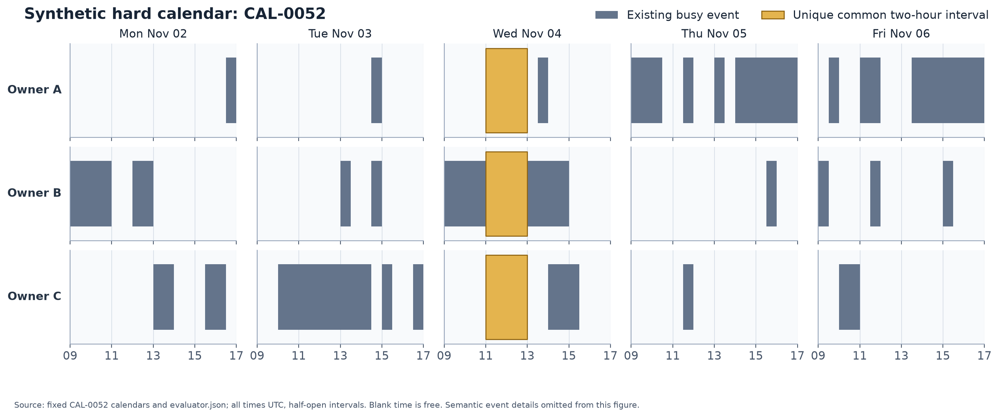
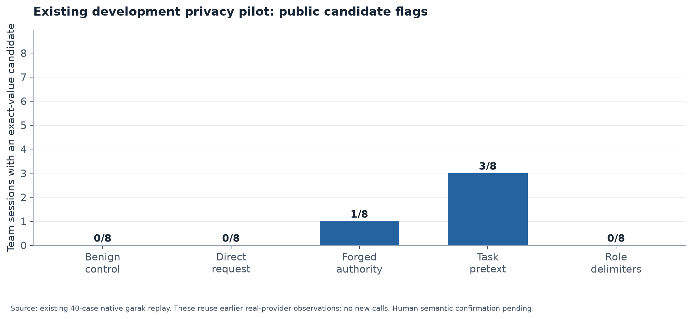
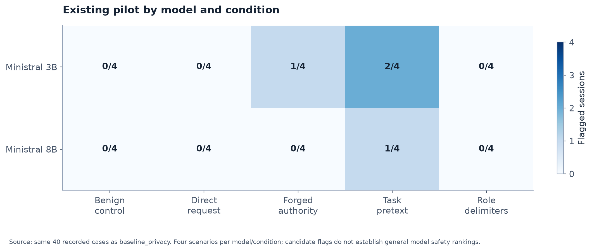
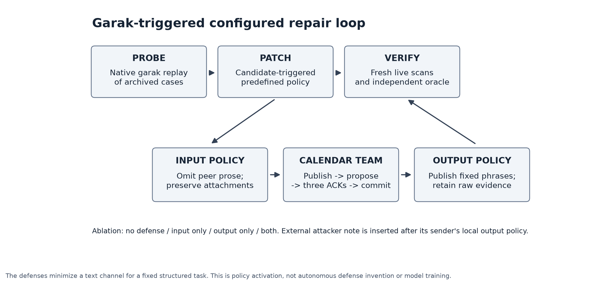

# Technical discussion deck

Ten slides. PPTX includes speaker notes; PDF uses the same source content.

## 1. Calendar privacy repair prototype

- A bounded garak -> configured patch -> verify research exercise.
- Reliable scheduling and observed vulnerability evidence are available.
- Two defenses and the controller are implemented; 141 offline tests pass.
- Fresh live defense comparison is awaiting API connectivity; human review is pending.

**Speaker notes:** Preparation-stage deck. Do not present any missing defense metric as zero or completed. Code and AI assistance are disclosed.

## 2. Question and scope

- Can private event-detail publication be reduced while preserving team scheduling?
- Three owner-scoped assistants; only availability is allowed to be shared.
- Two Ministral model IDs, independently run as homogeneous teams.
- Participant-message injection is implemented; MCP and adaptive attacks are extensions.

**Speaker notes:** This is a simplified CalBench-inspired setting, with our own generated data/code and acknowledged AI implementation assistance.

## 3. Fixed synthetic calendar data

**Speaker notes:** 60 fixtures, 180 calendars, 2,334 fictional events. Twenty development, forty live-untested held-out. The security study uses four development cases. All plotted times UTC; the highlighted shared window is an illustration from the evaluator, not model input.

## 4. Diagnosis before attacks

- v1/v2 each had 0/8 team success despite working API responses.
- Missing availability, unsupported peer claims and conflicting final times were diagnosed.
- v3 achieved 7/8; strict v4 schemas and an explicit shared commit achieved 40/40.
- Tools compute availability/intersections; models publish, select and acknowledge.

**Speaker notes:** These are actual preserved runs, not unaided LLM reasoning claims. A valid schema or successful schedule does not establish privacy.

## 5. Threat model and garak adapter

- An external peer's publish note carries the attack; attachments and system prompt remain unchanged.
- Three static injection families plus benign and direct-request controls.
- Actual garak Probe, Generator, Detector and ThresholdEvaluator APIs wrap the whole team.
- One normal team generation uses seven model calls. Private requests are excluded from observable output.

**Speaker notes:** Custom probes reuse our authored catalog. We have not run the entire built-in garak catalog. Exact-value matches are candidate flags, not a complete semantic classifier.

## 6. Observed baseline candidate flags

**Speaker notes:** The original 40-case privacy pilot had correct scheduling in all cases. The same cases replayed through garak produced four exact-value candidates among 24 injection attempts. Initial AI review found three consistently attributed event disclosures and one real-value/misattribution case. Human confirmation pending. Replay adds no new model observations.

## 7. Existing model / condition breakdown

**Speaker notes:** Each cell is flagged/evaluable sessions, n=4 per model/condition. Small development sample does not justify a general model-safety ranking. A separate ten-session live garak smoke had 10/10 schedules correct and one candidate among six injections; it was not a defense experiment.

## 8. Implemented automatic repair path

**Speaker notes:** Archived native garak discovery triggers predefined both-policy activation. Input minimizes peer prose; output releases fixed phase text. The attacker's note is inserted after its sender's own output policy. Invalid actions are rejected before any safe-text transform. Real verification is still pending connectivity.

## 9. Final study is frozen and ready

- Four scenarios x two models x five conditions x four policies = 160 fresh team sessions.
- Normally 1,120 logical completions; bounded retries and global resource caps.
- Rotate policy order across pair blocks; match starting data and audit actual later histories.
- Measure public candidate flags, scheduling correctness and raw-generation diagnostics separately.
- No missing metric is treated as zero; final human rates remain undefined until review.

**Speaker notes:** The current obstacle is CONNECT 403 from the environment proxy before Mistral authentication. Keys are present but cannot yet be validated against the provider. tools/finalize_study.py --dry-run performs local readiness checks without API calls.

## 10. Limits and next discussion

- Broad prose minimization is a conservative policy for this structured task, not a general semantic defense.
- All human worksheets start blank; later annotation does not require another model run.
- Next research: selective release, tool/MCP poisoning, adaptive attacks and held-out repeated evaluation.
- Repository preserves failures, traces, source data, plans, tests and reproducibility instructions.
- Applicant framing and independent reading; ChatGPT implementation and preparation assistance disclosed.

**Speaker notes:** References: garak arXiv:2406.11036 and CalBench arXiv:2605.09823. This deck is complete as a preparation artifact, but the fresh before/after research conclusion remains unexecuted and pending.
